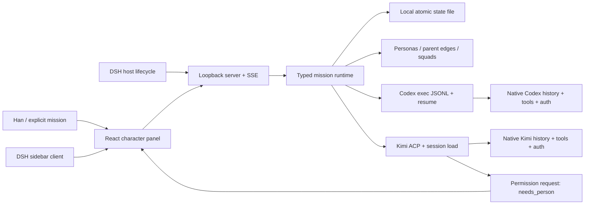

# Dot Swarm · 点与群

**把 Codex 与 Kimi 原生会话变成可管理的角色。平级派单与层级小队，可以同时存在。**

一个可链接安装的 [DeepSeek Harness](https://github.com/deepseek-ai/deepseek-harness) 插件包，附带本地 React 角色面板。Phase 1 支持 **Codex + Kimi**：创建角色、直接派单、小队派单、原生会话续接、输出流、状态、权限决策与取消。不是通用 LLM 聊天套壳，也不替换这两个 CLI 的登录、工具循环和原生历史。

## 为什么做

Han 现在以平级方式管理 agent：自己判断任务，再把工作投到合适的会话或客户端（Kimi、Codex、Claude Code、Grok Bot）。现实约束是多个约 $20 的套餐并行使用，而非每个工具都升级 Max / $100。最痛的部分是**分诊、切换和跟进所消耗的注意力**，不是单纯多买算力。

[Ethan Mollick 的 The Dot and the Swarm](https://www.oneusefulthing.org/p/the-dot-and-the-swarm) 提供了一个启发：组织工作本身也可以被 AI 学会。对 Han 而言，agent 比人更容易试验不同的组织方式；好的架构应允许平级与层级共存。产品直觉是把关键 agent 人格化、虚拟化，像游戏引擎里的角色一样看见和管理。

我们采用 [DeepSeek Superagent 的注意力原则](https://github.com/deepseek-ai/dsh-superagent-prototype/blob/main/docs/000-philosophy.md)：只在被要求或书面规则允许时行动，只在需要人做决定或结果对人有用时发声。**本 MVP 只实现显式的人类派单**；没有默认轮询模型、自动转派、后台规划或消息推送。角色的 role 是组织标签，不会偷偷改写原生系统提示词。界面的实时状态不消耗模型调用。

## 快速运行面板

需要 Node.js **22.19+**（推荐 24+）、pnpm **10.32.1**、Git；原生 CLI 需自行安装并登录。

```bash
git clone https://github.com/missminga/dot-swarm.git
cd dot-swarm
corepack enable
pnpm install
pnpm check                  # 类型检查 + 无凭据测试 + 构建
pnpm start
```

打开 **http://127.0.0.1:4317**。默认工作目录是启动命令所在目录，界面顶部会显示它。初始没有角色，也不会执行任务。开发时先 `pnpm build`，再 `pnpm dev`；面板源码修改后重新 build 并刷新浏览器。

```bash
# 可选：明确指定所有角色工作的目录
DOT_SWARM_WORKSPACE=/absolute/path/to/your/git-project pnpm start

# 不发起模型请求，只检查 CLI 可执行性、版本并展示将使用的命令
pnpm dry-run codex
pnpm dry-run kimi

# 缺失 CLI 的错误路径：应非零退出，并给出安装/路径提示
DOT_SWARM_CODEX=/missing/codex pnpm dry-run codex
DOT_SWARM_KIMI=/missing/kimi pnpm dry-run kimi
```

创建一个 Codex 角色和一个 Kimi 角色，在「Assign to」选角色，填写短任务并点击 **Launch mission**。Kimi 可以先用 `/status` 测试原生状态输出，不需要模型生成。Codex 可以用 `Reply with exactly DOT_SWARM_OK. Do not use any tools.` 测试一次模型调用。真实任务会使用 CLI 原有账户及额度。

## 安装到 DSH

兼容版本精确锁定为 **`@deepseek-ai/dsh@0.2.1-rc.5`**；DSH 尚在预览期，升级前需要重验插件 API。参考上游的 [npm 安装方式](https://github.com/deepseek-ai/deepseek-harness#run-from-npm)。下面使用独立安装和 profile 目录，便于复现：

```bash
# 在 dot-swarm checkout 中执行
pnpm install
pnpm build

export DSH_RUNTIME="$HOME/.local/share/dot-swarm-dsh-runtime"
export DSH_HOME="$HOME/.local/share/dot-swarm-dsh-profile"
npm install --prefix "$DSH_RUNTIME" @deepseek-ai/dsh@0.2.1-rc.5
export PATH="$DSH_RUNTIME/node_modules/.bin:$PATH"

# 标准 bundle link 安装；checkout 必须保持在此路径
# 已有兼容 DSH 时，也可直接在其 profile 下运行这条命令
dsh plugin --profile web add "link:$PWD"

export DOT_SWARM_WORKSPACE="$PWD"
dsh web --no-open
```

用终端打印的 DSH 登录 URL 打开 Harness。左侧 **Dot Swarm → Open character panel** 打开本机 `127.0.0.1:4317`。无需配置 DSH 的模型 provider 就能使用本插件；Codex/Kimi 各自管理凭据。插件 host 启动并服务面板，client 注册 DSH sidebar/main slot。停用插件或关闭 DSH 时会取消活动任务并关闭面板服务。

**同一台机器只运行一个 Dot Swarm host**：独立 `pnpm start` 和 DSH 插件二选一，否则 4317 端口冲突会清楚报错。面板只支持本机浏览器，不支持远程 DSH、反向代理或 LAN 访问。`localhost` 不作为别名，请使用 `127.0.0.1`。

更新代码后 `pnpm install && pnpm check`，重启 DSH。也可 `pnpm pack` 后以生成的 `.tgz` 安装；构建产物和双端入口已包含在包内。卸载：`dsh plugin --profile web remove dsh-dot-swarm`，然后重启。卸载不删除角色和历史。

## 怎么组织工作

- **Persona**：`id / displayName / role / avatar / engine / status / currentTaskSummary / parentId`，附带最近的 `nativeSessionId`。`parentId: null` 表示平级伙伴；改父节点时拒绝循环。
- **Mission / Ticket**：明确的人类授权、短任务、1–4 位角色或一个 Squad、每位角色独立的执行记录。一个角色同时只能执行一项任务，全局最多 4 个原生进程。
- **Squad**：名字、成员、lead。lead 必须是成员；小队关系与 Persona 的汇报边独立。lead 在 v1 是协调标记，不会自动拆解任务。

小队派单会把**同一条任务**交给每位成员，在**同一工作目录**分别运行。没有自动分工、隔离 worktree、合并或多模型讨论；适合并行观察、独立研究或复核。需要拆分工作时直接给成员分别派单。角色在层级或小队中，仍然可以接平级直派任务。



React + CSS 足以承载角色、状态、表单和 SVG 层级边，包更小，也更容易测试、键盘操作和维护。v1 没有引入重型游戏引擎；角色外观是原创 CSS 小机器人，未来可以替换成 sprite，调度模型不用跟着重写。

## 原生命令与状态

完整协议、终止与降级说明见 [docs/adapters.md](docs/adapters.md)。在这台 Mac 上探测到 Codex **0.166.0** 和 Kimi **2.4.0**。

| 引擎 | 实际执行 | 原生续接 | v1 权限 |
|---|---|---|---|
| Codex | `/opt/homebrew/bin/codex -c 'sandbox_mode="read-only"' -c 'approval_policy="never"' exec --json --color never -`，任务走 stdin | 同一全局配置 + `exec resume --json THREAD_ID -` | 只读；没有交互审批通道 |
| Kimi | `~/.kimi-code/bin/kimi acp`，stdio JSON-RPC | `session/load` 后 `session/prompt` | 保留原生权限，ACP 决策在面板显示 |

两者都使用固定工作目录、参数数组及 `shell: false`。可用 `DOT_SWARM_CODEX` / `DOT_SWARM_KIMI` 覆盖可执行路径；默认先找上述 Mac 路径，再找 PATH。不会读取、复制或改写 CLI 账户文件，也不代理模型 API。

Persona 状态为 `idle / working / blocked / needs_person`。命令缺失、协议错误、超时和异常退出会变成 blocked；Kimi 权限请求变成 needs_person。默认 10 分钟超时（包括等待权限），取消先走原生通知（Kimi）和进程组 SIGTERM，1.5 秒后 SIGKILL。无自动重试。重启时未完成记录变成 blocked；若 host 被强制杀死，先检查原生 CLI 是否仍运行，再手动续接。

**Continue each native session** 只发送新任务到该角色最近的原生 session，不回灌整段历史。每次任务输出保留最多 24,000 字符；可展开 Native output，查看原生 session ID，并复制 native resume 命令。默认不续接时新建原生会话。

## 数据与边界

本地元数据保存到 `~/.local/state/dot-swarm/<workspace-hash>/state.json`（目录 0700、文件 0600）；可用 `DOT_SWARM_STATE_FILE` 指定。状态包含任务和有界的输出，不包含插件管理的凭据。活动任务以外保留最近约 30 项，流写入最多延迟 200ms；原生 CLI 历史仍由各 CLI 保存。正常退出会刷盘，使用临时文件 + rename 防止半写 JSON；不承诺断电 fsync 或多个 host 同写。

面板有 Host/Origin 检查、JSON 请求限制、SSE 连接上限和输入大小上限，无遥测、外部字体或 CDN。它是单人本机工具，同机进程属于可信边界；不要把端口暴露到公网。CLI 输出可能含私有内容，分享任务日志前自行检查。`.env`、日志、构建输出、tarball 和本地状态路径已忽略，仓库不需要 API key。

## Phase 1 限制 / 下一步

- Codex exec 输出是原生 JSONL 活动及已完成消息，不是 app-server 的逐 token delta。写操作、审批、mid-turn steer、Desktop session docking 是明确 TODO。
- Kimi ACP 完整对话由 CLI 执行，面板承接文本和权限选项；不支持扩展 elicitation、多选问卷、附件和终端嵌入。缺失 ACP 时清楚失败，不静默改用可能自动授权的 print 模式。
- 本机 Kimi 2.4.0 的 `/status` 可流式返回并续接；测试中普通模型提示有时只返回 `end_turn` 而无助手输出。此时任务被标为 blocked，保留原生 session ID，需到原生 CLI 检查。不会把空结果宣称为完成，也不会自动重试或改账号配置。
- 没有导入现有 Desktop 会话、跨引擎历史搬运、费用统计、消息桥、cron、书面规则执行器、后台 lead agent 或自动调度。
- 删除/归档角色、编辑角色资料、worktree 隔离及完整原生 session docking 留到后续。v1 可调整 parent，并创建角色/小队。
- **Phase 2 才考虑 Claude Code**；当前代码、引擎枚举、依赖与执行路径均不集成它。

## 开发与验证

```bash
pnpm install --frozen-lockfile
pnpm test                   # 不调用真实模型，不需要 CLI 或账户
pnpm check                  # tsc + tests + build
pnpm dry-run codex
pnpm dry-run kimi
pnpm pack                   # 生成可安装包
```

测试用小型真实子进程模拟 JSONL/ACP 协议，覆盖启动、流、session 续接、权限暂停、取消、超时、缺失 CLI、坏协议、空结束、状态恢复、层级循环、小队直派和 HTTP 边界。GitHub Actions 在 Linux / Node 24 执行同一套检查。实际验证记录和参考仓库 commit 见 [docs/references.md](docs/references.md)。

## 参考与许可

研究了 [DeepSeek Harness](https://github.com/deepseek-ai/deepseek-harness)、[Superagent prototype](https://github.com/deepseek-ai/dsh-superagent-prototype)、[dsh-harness-ally](https://github.com/BaronCyrus/dsh-harness-ally)、[dsh-loop-engine](https://github.com/kuun993/dsh-loop-engine)、[dsh-kimi-bridge](https://github.com/pandashere/dsh-kimi-bridge)、[dsh-codex-bridge](https://github.com/juyanjy/dsh-codex-bridge) 的原生桥接与生命周期模式；参考克隆仅位于 `/tmp`，未整包 vendor 社区实现。

[MIT License](LICENSE)。独立社区项目，不是 DeepSeek、OpenAI 或 Moonshot 的官方产品。
